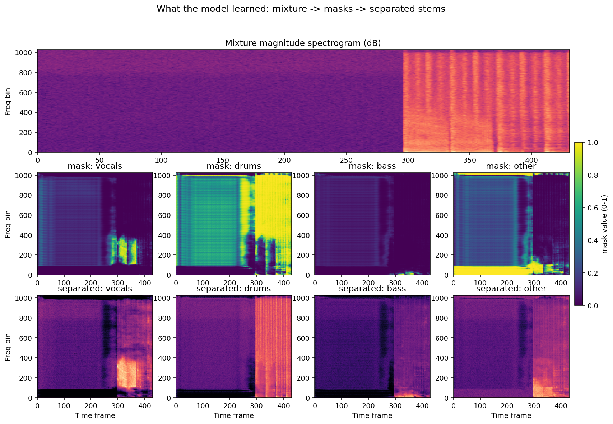
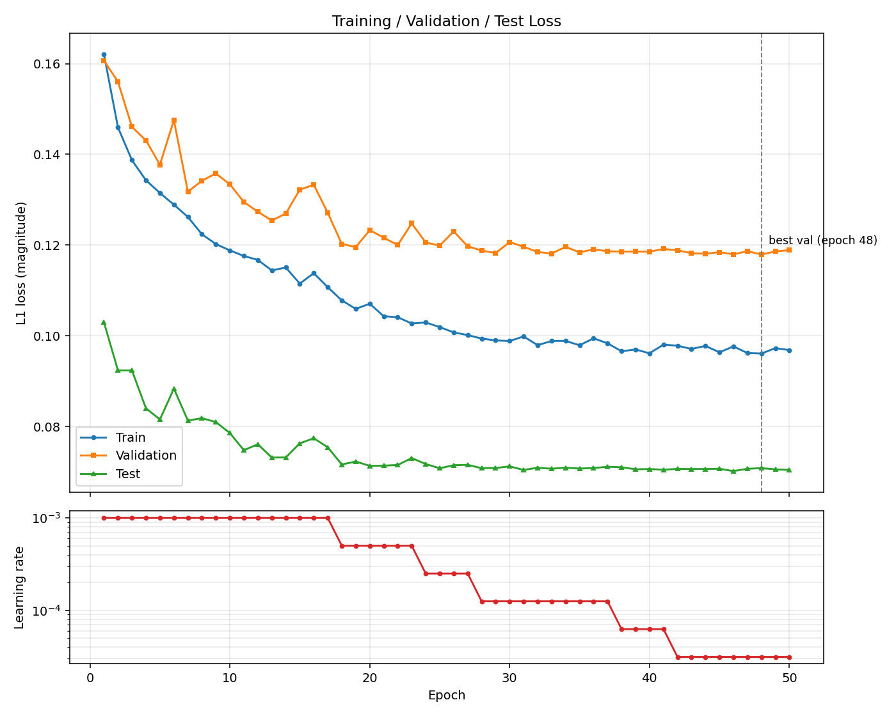
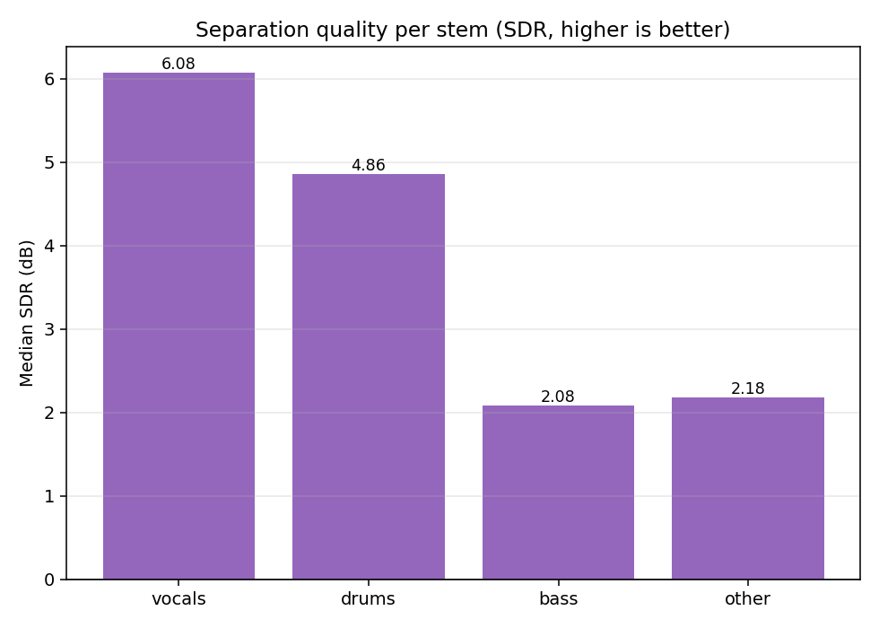

# Music Source Separation: Spectrogram U-Net

A from-scratch **PyTorch** system that splits a song into four stems (**vocals, drums, bass, other**). It is trained on [MUSDB18-HQ](https://sigsep.github.io/datasets/musdb.html) using a magnitude-masking U-Net.

> EE302 Deep Learning project, Özyeğin University



---

## Results

Evaluated on the MUSDB18-HQ test set. SDR, SIR and SAR are in dB (higher is better).

| Stem | SDR | SIR | SAR |
|---|---|---|---|
| Vocals | **6.08** | 13.63 | 7.01 |
| Drums | **4.86** | 11.63 | 6.65 |
| Bass | **2.08** | 4.99 | 6.70 |
| Other | **2.18** | 7.29 | 4.94 |

*Model: 17.46M parameters, base channels 48, 5 s segments, batch 6, 50 epochs (best at epoch 48).*

### Model size comparison

| Config | Params | Vocals | Drums | Bass | Other | Test L1 |
|---|---|---|---|---|---|---|
| `b4_c32_s3` (batch 4, 32 ch, 3 s) | 7.76M | 5.67 | 4.95 | 2.32 | 2.20 | 0.0683 |
| `b6_c48_s5` (batch 6, 48 ch, 5 s) | 17.46M | 6.08 | 4.86 | 2.08 | 2.18 | 0.0712 |

Doubling model size improves vocals, but the other stems stay about the same. With only 92 training songs, the data is the bottleneck, not model capacity.

<p>
  
  
</p>

Full reports: [`results/b48/evaluation_report.md`](results/b48/evaluation_report.md), [`results/b32/evaluation_report.md`](results/b32/evaluation_report.md)

---

## How it works

```
waveform ──STFT──► magnitude + phase
                      │        └──── kept aside
                      ▼
            U-Net → 4 softmax masks (one per stem)
                      │
         stem magnitude = mask × mixture magnitude
                      │  + original mixture phase
                      ▼
                   iSTFT ──► 4 separated waveforms
```

- **Magnitude-only prediction.** The phase is reused from the mixture, which is a standard and effective baseline approximation.
- **Softmax across sources.** At every time-frequency bin the 4 masks sum to 1, so the stems add back up exactly to the mixture.
- **U-Net** with an encoder/decoder and skip connections. Channel width doubles at each level.
- **GPU-side STFT.** The dataset returns raw waveforms and the STFT is computed in one batch on the GPU, so CPU data loaders don't become a bottleneck.
- **Training:** Adam, L1 loss on stem magnitudes, `ReduceLROnPlateau`, mixed precision (AMP). The best checkpoint is chosen by validation loss.
- **Inference:** left and right channels are separated independently (stereo output) with overlap-add windows, so there are no clicks at chunk boundaries.

STFT settings: 44.1 kHz, `n_fft = 2048`, `hop = 512`.

## Files

| File | Purpose |
|---|---|
| `config.py` | All hyperparameters and paths |
| `dataset.py` | `MUSDBDataset`: random 3–5 s crops for training, fixed offsets for validation/test |
| `model.py` | U-Net architecture (`python model.py` runs a shape self-test) |
| `train.py` | Training loop |
| `predict.py` | Separate any 44.1 kHz `.wav` into 4 stems |
| `evaluate.py` | Loss + SDR/SIR/SAR, plots, and a markdown report |
| `compare.py` | Side-by-side comparison of multiple runs |
| `results/` | Evaluation outputs for both model configs |

## Getting started

```bash
pip install torch --index-url https://download.pytorch.org/whl/cu121
pip install -r requirements.txt
```

Download **MUSDB18-HQ** (not included in this repo) and point to it:

```bash
export MUSDB_PATH=/path/to/musdb18hq      # Windows: $env:MUSDB_PATH="C:\path\to\musdb18hq"
```

Expected layout: `musdb18hq/{train,test}/<track>/{mixture,vocals,drums,bass,other}.wav`. The 100 train tracks are split 92/8 into train/validation; the 50 test tracks are held out.

```bash
python model.py                                   # sanity check
python train.py                                   # train → checkpoints/best_unet_baseline.pth
python evaluate.py                                # metrics + plots → evaluation_output/
python predict.py --input path/to/mixture.wav     # stems → separated_output/
python compare.py runs/run_a runs/run_b           # compare runs
```

A CUDA GPU is strongly recommended. Training was done on an RTX 4070 (~12 min/epoch for the 48-channel model).

## Limitations

This is a small model trained from scratch on 92 songs. Vocals and drums separate reasonably well, while bass and "other" show bleed. The gap between train and validation loss reflects the limited dataset. The next step would be a band-split / complex-spectrogram model (e.g. SpecBandNet), compared using the same evaluation pipeline.

## Author

**Bahittin Can Acar**
